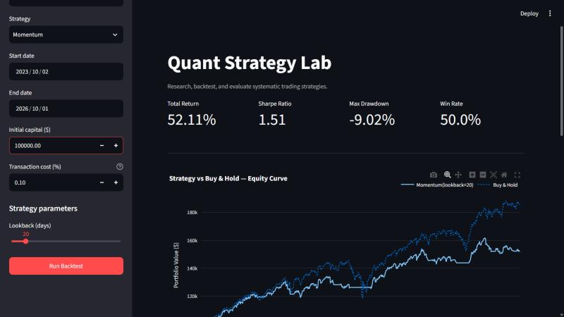
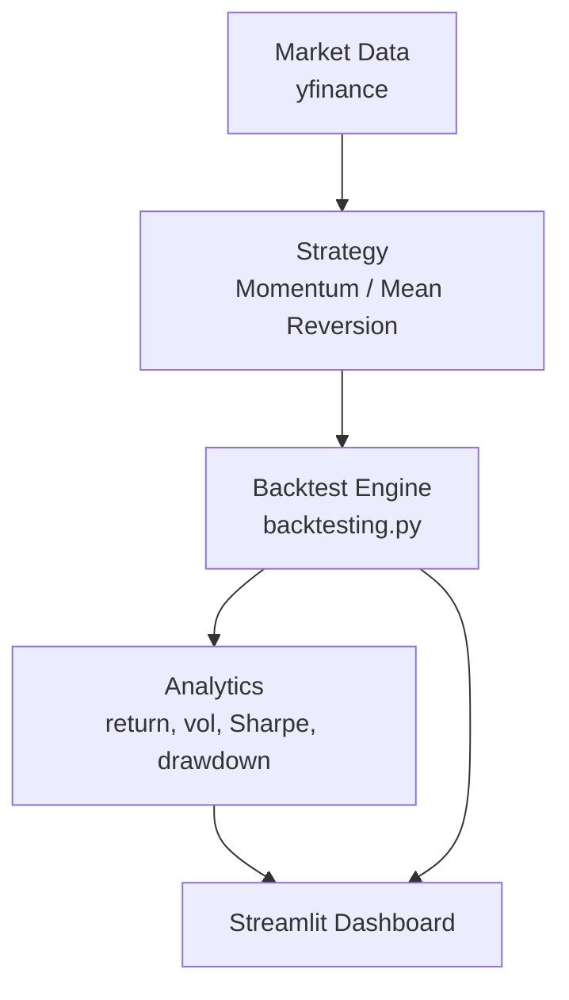

# Quant Strategy Lab

A small, self-contained platform for researching and backtesting systematic
trading strategies on daily equity data — built to demonstrate software
engineering, applied statistics, and an understanding of backtesting
methodology, not to claim a profitable trading system.

## Demo



*Momentum strategy on SPY (live Yahoo Finance data, 3-year window), run locally.*

## Features

- Pick a ticker (SPY, QQQ, AAPL, MSFT), a strategy, a date range, starting
  capital, transaction cost, and strategy parameters from a sidebar.
- Two long-only strategies: **Momentum** and **Mean Reversion**.
- A real backtest engine ([backtesting.py](https://kernc.github.io/backtesting.py/))
  handling order fills, cash, and positions — not a hand-rolled simulation.
- Headline metrics: Total Return, Annualized Return, Annualized Volatility,
  Sharpe Ratio, Max Drawdown, Win Rate, Number of Trades.
- Interactive equity curve vs. a Buy & Hold benchmark, plus a trade log.
- A documented execution assumption that avoids look-ahead bias (see
  "Avoiding Backtesting Bias" below).
- Unit-tested metrics and signal logic, with a CI pipeline that runs on
  every push.

## Architecture



```
Market Data  →  Strategy  →  Backtest Engine  →  Analytics  →  Dashboard
```

Strategies only compute a target position (long/flat) from price history —
they never touch orders, cash, or commissions. The backtest engine (a thin
wrapper around backtesting.py) is the only place that executes trades. This
split means adding a new strategy never requires touching execution code,
and vice versa.

## Strategies

### Momentum

Go long when the trailing *N*-day return is positive, flat otherwise:

```
signal[t] = LONG   if  Close[t] / Close[t - N] - 1 > 0
            FLAT   otherwise
```

`N` (lookback) is configurable in the sidebar. This is a simple trend
filter — it does not try to predict returns, only to follow a trend that
has already started.

### Mean Reversion

Go long when price is far enough below its rolling mean, and exit once it
has reverted:

```
z[t] = (Close[t] - rolling_mean(Close, N)) / rolling_std(Close, N)

enter long when z <= entry_z
exit to flat  when z >= exit_z
```

Lookback `N`, `entry_z`, and `exit_z` are all configurable. Entry/exit uses
hysteresis (two different thresholds) so a position isn't opened and closed
on every tick once triggered — it's held until price has genuinely reverted.

Both strategies are long-only (no shorting) and deliberately simple enough
to be explained, line by line, in an interview.

## Metrics

All metrics are implemented from scratch in `src/analytics/metrics.py`
(rather than only reading backtesting.py's own summary) so the formulas are
transparent and unit-tested.

| Metric | Formula |
|---|---|
| Total Return | `Equity[-1] / Equity[0] - 1` |
| Annualized Return | `(1 + TotalReturn)^(252 / n_periods) - 1` |
| Annualized Volatility | `std(period_returns) * sqrt(252)` |
| Sharpe Ratio | `mean(excess_returns) / std(excess_returns) * sqrt(252)` |
| Max Drawdown | `min(Equity[t] / running_max(Equity)[t] - 1)` |
| Win Rate | `fraction of closed trades with PnL > 0` |

**Note on Sharpe Ratio:** this project uses the standard textbook
definition (arithmetic mean of period excess returns, divided by their
standard deviation, annualized). backtesting.py's own built-in Sharpe
number uses a different formula — annualized *CAGR* divided by annualized
volatility — so the two numbers will generally **not** match exactly. Both
are legitimate; they answer slightly different questions. This is
documented rather than "fixed" because it is a real difference in
definitions, not a bug.

## Avoiding Backtesting Bias

- **Look-ahead bias:** a strategy's signal for bar *t* is computed only
  from `data.iloc[:t+1]` (rolling/expanding windows looking backward).
  backtesting.py's default order semantics additionally fill an order
  placed while processing bar *t* at bar **t+1's open** — so a signal is
  never assumed tradable before the market had a chance to react to the
  information it's based on.
- **Transaction costs:** every fill pays the commission rate configured in
  the sidebar (default 0.10%). Costs are not optional or hidden.
- **No parameter fitting on this data:** strategy parameters are set by
  the user, not searched/optimized against the backtest period. Trying
  many parameter combinations and reporting only the best one (without a
  held-out test period) would make the results look better than they'd
  actually be — this app doesn't do that.
- **Benchmark:** every backtest is compared against a simple Buy & Hold of
  the same ticker over the same period, not a cherry-picked baseline.
- **Limitations:** this is a single-asset, long-only, daily-bar backtest
  with no slippage model, no market-impact model, and no survivorship-bias
  handling in the underlying data (it uses whatever yfinance returns for
  each ticker today). It is a research/educational tool, not a
  production trading system.

**Disclaimer:** This project is for educational and research purposes
only. It is not financial advice, and backtested performance does not
indicate future results.

## Installation

```bash
git clone <your-repo-url>
cd quant-strategy-lab
pip install -r requirements.txt
```

Requires Python 3.11+.

## Running the Application

```bash
streamlit run app.py
```

Then open the URL Streamlit prints (usually `http://localhost:8501`), pick
a ticker/strategy/date range in the sidebar, and click **Run Backtest**.

## Running Tests

```bash
pytest -v
```

All 34 tests use deterministic, synthetic data and do not require network
access — they will pass with no internet connection.

## Project Structure

```
quant-strategy-lab/
├── app.py                      # Streamlit UI (wiring only)
├── src/
│   ├── data/
│   │   └── loader.py            # yfinance download, validation, cleaning
│   ├── strategies/
│   │   ├── base.py               # SignalStrategy abstract interface
│   │   ├── momentum.py
│   │   └── mean_reversion.py
│   ├── backtest/
│   │   └── engine.py             # backtesting.py integration
│   └── analytics/
│       └── metrics.py            # return/vol/Sharpe/drawdown/win-rate
├── tests/
│   ├── test_metrics.py
│   └── test_strategies.py
├── .github/workflows/tests.yml   # CI: install + pytest on every push
├── requirements.txt
└── LICENSE
```

## Example Analysis

Run the app with, e.g., `AAPL`, `Momentum`, lookback `20`, over the last 3
years, and compare the resulting Sharpe Ratio and Max Drawdown against the
Buy & Hold benchmark for the same period. Repeat with `Mean Reversion` on
the same ticker/period to see how a trend-following and a
reversion-based approach diverge on identical data — that comparison, more
than either number in isolation, is the interesting result.

(Actual figures aren't reproduced here since they depend on the live data
at the time you run it — screenshot your own run for the Demo section
above.)

## Limitations

- Long-only, single-asset, daily-bar backtests — no shorting, no
  portfolio-level (multi-asset) backtesting, no intraday data.
- No slippage or market-impact modeling beyond a flat commission rate.
- Strategy parameters are fixed by the user, not fit or validated
  out-of-sample.
- Data quality depends entirely on what yfinance returns.

## Future Work

- Portfolio-level backtesting across multiple tickers.
- Parameter sensitivity analysis (e.g. a lookback × threshold heatmap).
- Walk-forward validation instead of a single fixed backtest window.
- Factor research beyond price-based signals.
- `vectorbt` integration for fast parameter sweeps.
- ML-based strategies (e.g. via Qlib), added only after the above
  statistical foundations are solid — not as a shortcut around them.

---

*Educational/research project. Not financial advice.*
